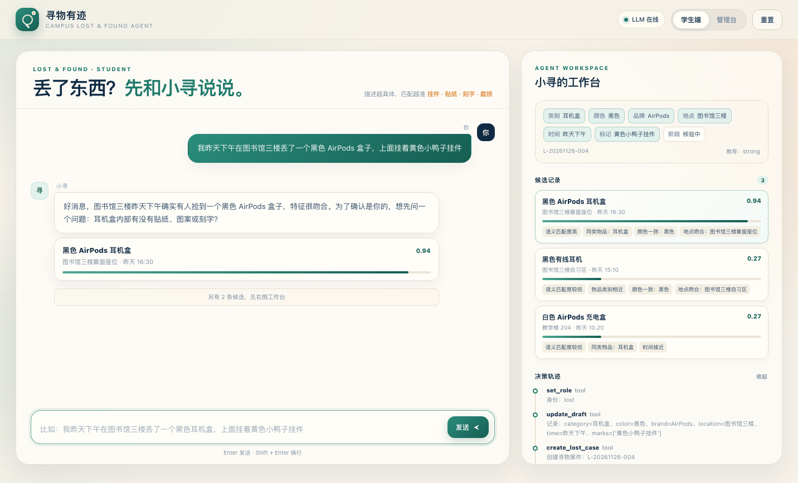
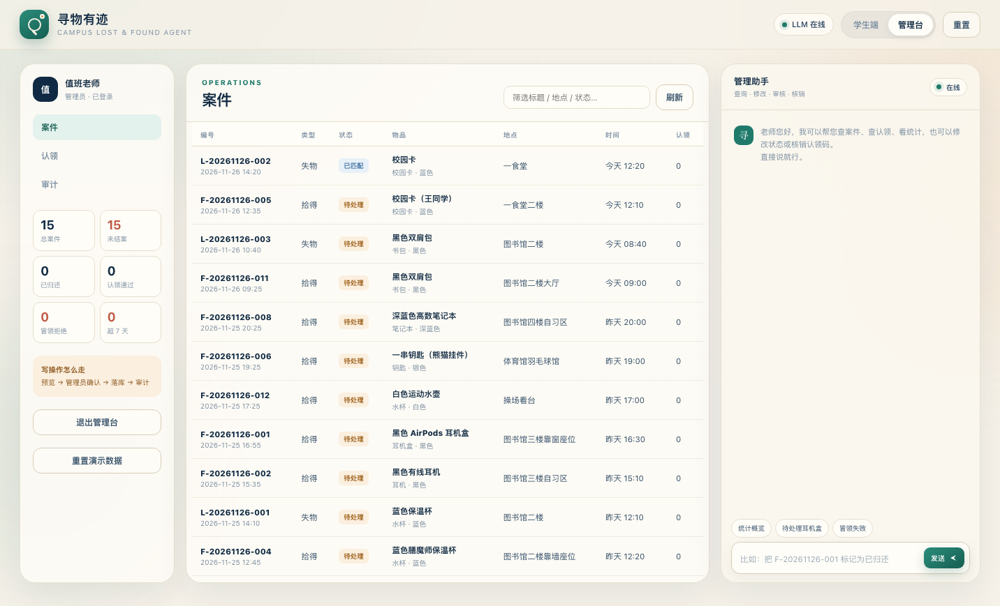

# 寻物有迹 · 校园失物招领 Agent

> 当前版本：**v0.4 Web 学生端 + 管理端**
> 这一版把“理解、追问、选工具、匹配重排、语义核验、措辞”全部交给 LLM；代码只保留工具、状态和不可绕过的风控。

## 这个 Agent 解决什么

校园失物招领的难点不是“没有数据库”，而是三件事：

1. **两侧信息不对称**：失主知道物品长什么样，但不知道它在哪；拾得者知道在哪捡的，但不知道是谁的。
2. **描述天然不完整**：用户不会主动说出“挂件、贴纸、刻字、磨损”这些真正能区分物品的细节，需要 Agent 主动追问。
3. **认领有风险**：相似物品很多，把东西给错人比找不到更糟。Agent 必须在交接前做归属核验。

所以它不是“聊天框 + 数据库查询”，而是一个会规划、会调工具、会核验、有隐私边界的 Agent。

## 快速运行（Web）

无需安装第三方依赖，Python 3.9+ 即可：

```bash
cp .env.example .env
# 编辑 .env，填入 LLM_API_KEY / LLM_BASE_URL / LLM_MODEL
python3 server.py
```

打开 **http://127.0.0.1:8000**。

页面包含：

- **学生端**：对话、候选记录、当前线索、Agent 决策轨迹、认领凭证；
- **管理台**：管理员口令登录、案件/认领/审计表格、案件详情、自然语言管理助手、修改预览/确认；
- **新对话**：右上角「新对话」清空当前学生会话，或为管理端开一个新的管理会话；不会重置案件数据（重置是另一个按钮）。





常用环境变量：

```bash
LF_WEB_PORT=8000      # 换端口
ADMIN_PASSWORD=...    # 管理台密码
```

> 也可以不用网页，直接用命令行调试：`python3 scripts/chat_cli.py --reset`。

## 自动演示（离线）

不依赖 LLM、网络或本地模型，适合现场网络不稳定时直接播放：

- 地址：`http://127.0.0.1:8000/demo.html`（启动 `python3 server.py` 后打开）；
- 也可以直接打开 `web/demo.html`，页面使用相对路径加载 `demo.css` / `demo.js`；
- 约 70 秒，带旁白与底部大字讲解；点击一次「开始播放（含旁白）」后全自动播放，支持暂停 / 重播；
- 旁白音频在 `web/narration/`，是提前生成好的 MP3 文件，播放时不访问外部服务；
- 顶栏可随时开关旁白；开始页也有“静音播放”；
- 无人值守：`?auto=1&loop=1`（静音自动循环）；
- 调试参数：`?voiceSpeed=1.45` 调快旁白（默认 1.35），`?speed=2` 加速画面，`?loop=1` 循环播放，`?holdTicket=1` 停在认领码出现的位置；
- 旁白台词与真人录音替换说明：[docs/auto_demo_narration.md](docs/auto_demo_narration.md)。

## 命令行入口

```bash
python3 scripts/chat_cli.py --reset
```

进入后直接用自然语言对话。命令：

| 命令 | 作用 |
|---|---|
| `/admin` | 输入管理员密码，进入管理端 |
| `/exitadmin` | 从管理端返回学生端 |
| `/new` | 开一个新会话（学生/管理各自独立） |
| `/reset` | 重置演示数据 |
| `/trace` | 开关决策轨迹 |
| `/mode` | 查看当前入口、模型模式、接口和最近错误 |
| `/quit` | 退出 |

> **没有规则兜底。** 未配置 Key、模型熔断或 API 调用失败时，Agent 会直接返回“模型服务暂时不可用”，不会静默降级成规则机器人。

## 它是怎么工作的

每一轮用户消息都会进入一个 ReAct 循环：

```text
用户消息
  → LLM 读取当前状态 + 工具列表
  → LLM 返回 tool_calls（可以一次多个）
  → 代码执行工具，把 observation 回传给 LLM
  → LLM 继续规划，直到给出最终回复
```

当前工具：

| 工具 | 作用 |
|---|---|
| `set_role` | 判断用户是失主还是拾得者 |
| `update_draft` | 把用户说的信息写入草稿，支持纠正 |
| `create_lost_case` | 创建寻物案件 |
| `create_found_case` | 创建拾得案件 |
| `search_found_cases` | 检索 + LLM 重排，返回候选和 recommendation |
| `start_verification` | 开始归属核验，只返回问题，不返回答案 |
| `submit_verification_answer` | 提交回答，返回下一题 / passed / failed |
| `finalize_claim` | 核验通过后生成认领码 |
| `escalate_to_staff` | 转人工复核 |

### 匹配为什么更准

不是纯向量检索，也不是纯关键词：

1. **代码召回**：字符 n-gram + 类别/颜色/地点/时间/独特标记的结构化打分，先取 Top 8；
2. **LLM 重排**：把失主描述和候选记录交给模型，按“独特标记是否一致、冲突是否明显”重新打分；
3. **推荐等级**：`strong / possible / weak`，LLM 据此决定直接核验、继续追问，还是告知暂无匹配。

### 隐私与风控

- 拾得者补充的“只有主人知道的细节”只存在于 `secret_detail` / `secrets`，不会进入公开描述；
- 如果模型误把同一个细节写进 `marks`，代码会在创建案件前撤回；
- 未核验通过前，不返回保管点、联系方式、内部细节；
- 核验通过后也只给认领码和领取地点，不复述私密细节；
- 核验失败会落一条 `rejected` 认领记录，并转人工；
- 默认不展示模型原始推理，避免推理复述用户刚说的核验细节；调试可设 `LF_SHOW_REASONING=1`。

## 建议测试剧本

### 剧本 A：失主认领（主链路）

```text
我昨天下午在图书馆三楼丢了一个黑色 AirPods 盒子，上面挂着黄色小鸭子挂件
盒盖内侧贴了蓝色皮卡丘贴纸
耳机是白色的
充电口有划痕
```

预期：LLM 自己完成 `set_role → update_draft → create_lost_case → search_found_cases → start_verification`，再逐个核验，最后 `finalize_claim` 生成认领码。

### 剧本 B：冒领者（风控链路）

`/new` 后：

```text
我昨天在图书馆丢了一个黑色耳机盒
不记得有什么贴纸
耳机应该是白色的
没有划痕
```

预期：核验失败，不生成认领码，转人工，并落一条 `rejected` 记录。

### 剧本 C：拾得登记（反向流程）

`/new` 后：

```text
我在纪忠楼二楼捡到一个白色鼠标，已经交到101了
底部贴了一张蓝色贴纸
今天上午
```

预期：Agent 会意识到“贴纸”是核验细节，不会写进公开特征；最后创建拾得案件，并保存一个只有主人知道的核验点。

## 管理员模式

管理员不是“学生 Agent 多开几个工具”，而是**独立的 Admin Agent**：独立工具集、独立权限、写操作先预览再确认、全程审计。

- **Web 端**：点右上角「管理台」，输入管理员密码；
- **CLI 端**：在同一个对话里输入 `/admin`，不需要另开进程：

```bash
python3 scripts/chat_cli.py
```

进入学生端后输入 `/admin`，再输入管理员密码即可：

```text
你 > /admin
管理员密码：******
[已进入管理端 · 管理员：值班老师]
管理台 > 统计一下各状态数量
...
管理台 > /exitadmin
[已返回学生端]
```

默认密码 `admin123`，可在 `.env` 里改：

```bash
ADMIN_PASSWORD=your-password
ADMIN_NAME=值班老师
```

直接用自然语言查询或修改，例如：

```text
统计一下各状态数量
查一下所有还没认领的黑色耳机盒
F-20261126-001 的认领记录和核验细节
把 F-20261126-001 标记为已归还
最近有哪些冒领失败
核销认领码 LF-XXXX
```

管理员工具：

| 工具 | 作用 |
|---|---|
| `admin_search_cases` | 按关键词/角色/状态/类别/地点/日期查案件 |
| `admin_get_case` | 查看完整详情（含核验细节、联系方式、认领、审计） |
| `admin_search_claims` | 查认领记录 |
| `admin_get_claim` | 查看单条认领的逐题回答与得分 |
| `admin_stats` | 状态分布、热门类别/地点、超 7 天未处理 |
| `admin_recent_events` | 审计日志 |
| `admin_preview_case_update` | 预览案件修改 |
| `admin_preview_claim_review` | 预览认领审核（通过/拒绝） |
| `admin_preview_redeem` | 预览认领码核销 |
| `admin_apply_pending_action` | 管理员确认后执行 |
| `admin_cancel_pending_action` | 取消待确认变更 |

**写操作的安全设计：**

1. 先调用 `admin_preview_*`，返回 `before → after` 预览，不落库；
2. Agent 把预览展示给管理员，等待明确确认；
3. 下一轮才允许 `admin_apply_pending_action`；同一轮内预览后立刻执行会被代码拒绝；
4. 执行后写 `admin_case_updated` / `admin_claim_reviewed` / `admin_claim_redeemed` 审计事件，包含管理员、原因、变更前后。

## 模型配置

```bash
LLM_API_KEY=你的key
LLM_BASE_URL=https://api.deepseek.com/v1
LLM_MODEL=deepseek-flash
LLM_MODE=live
```

- `LLM_MODE=live`：必须成功调用模型，失败即报错；推荐演示时使用。
- `LLM_MODE=auto`：有 Key 就调用，没有就报错（不会降级）。
- `LLM_MODE=mock`：仅用于离线测试，不是当前演示路径。

> 不要把 key 提交到 git；`.env` 已在 `.gitignore` 里。
> 核验时会把“只有主人知道的细节”发给模型做语义判断。课程 demo 可以接受；生产环境应做脱敏或改用本地模型。

## 当前实现结构

```text
agent/
  react_agent.py      LLM 自主规划 + 原生 tool calling 主循环（当前入口）
  llm.py              严格 LLM 客户端：tool calling、JSON、失败即抛错、熔断
  matching.py         代码召回 + LLM 重排
  matcher.py          字符 n-gram / 结构化匹配（召回层）
  nlu.py              标记清洗、语义核验 judge
  policy.py           核验机制与阈值（不可绕过）
  tools.py            登记、检索、核验、交接工具
  admin_agent.py      管理员 Agent：查询、统计、修改、审核、核销
  db.py               SQLite：案件、认领、审计事件
  seed.py             演示数据（含相似干扰项）
  legacy_rule_agent.py 旧规则状态机，仅保留作对比实验
scripts/
  chat_cli.py         统一 CLI 入口：/admin 切管理端，/exitadmin 返回学生端
server.py             零依赖 Web 服务：静态页面 + JSON API
web/
  index.html          页面结构（学生端 / 管理端）
  style.css           视觉样式
  app.js              对话、表格、详情弹窗、预览确认
  demo.html           离线自动演示（不调用 API）
  demo.css / demo.js  自动演示样式与脚本
  narration/          自动演示旁白 MP3
docs/screenshots/     页面截图
Presentation/
  寻物有迹.pptx       5 分钟汇报 PPT
  5分钟讲稿.md         汇报讲稿
```

## 已知限制

- Web 端已具备学生对话和管理台；在线模式每轮约 3–10 秒，长回复会慢一些。
- Web 端没有正式认证/多账号体系，管理员是单一共享密码。
- 管理端目前是单一共享密码，没有多管理员账号/角色分级；正式环境应接 SSO。
- 审计日志可查，但还没有“一键撤销”；修改前仍建议用预览确认。
- 工具调用步数上限 6 步，极端复杂对话可能触发保护。
- 拾得登记目前主要保存一个核验点，后续可拆成多个。
- 评测集、消融实验还没做；PPT 与讲稿在 `Presentation/`。
- 没有通知系统：Agent 不应承诺“会联系你/会通知你”，转人工只说已转服务台。
- 默认隐藏原始推理；`LF_SHOW_REASONING=1` 仅用于开发调试。

## 还可以补充什么

优先级建议：

1. **人工复核队列**：把 `rejected` 认领、`escalated` 案件、超 7 天未处理案件做成管理台首页待办。
2. **认领码二维码 + 核销台**：服务台扫码核销，防止一码多用（后端核销已通，二维码还没做）。
3. **导出 CSV/Excel**：按筛选条件导出案件和认领记录，方便服务台归档。
4. **多管理员与权限分级**：只读管理员 / 值班管理员 / 超级管理员，操作审计带账号。
5. **图片/多模态**：拾得者上传照片，管理端查看，后续可接入视觉匹配。
6. **数据保留与隐私**：联系方式脱敏展示、定期清理、访问日志保留周期。
7. **评测与消融**：代码召回 + LLM 重排 vs 规则匹配，主动追问 vs 不追问，做成答辩用的对比表。
